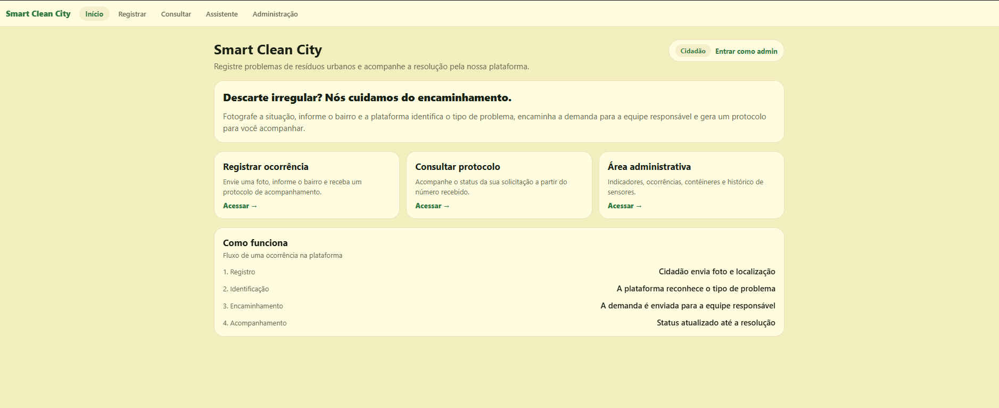
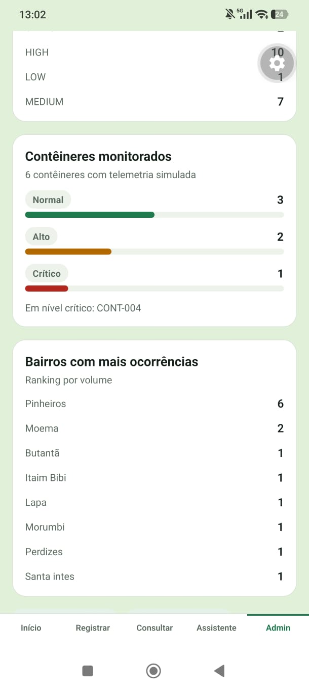
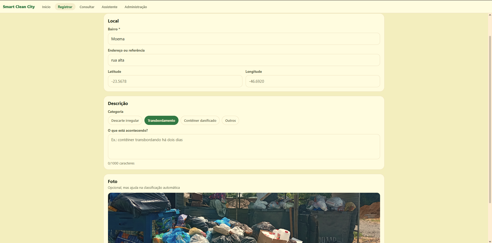
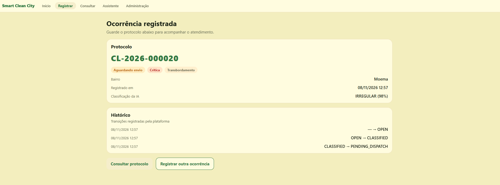
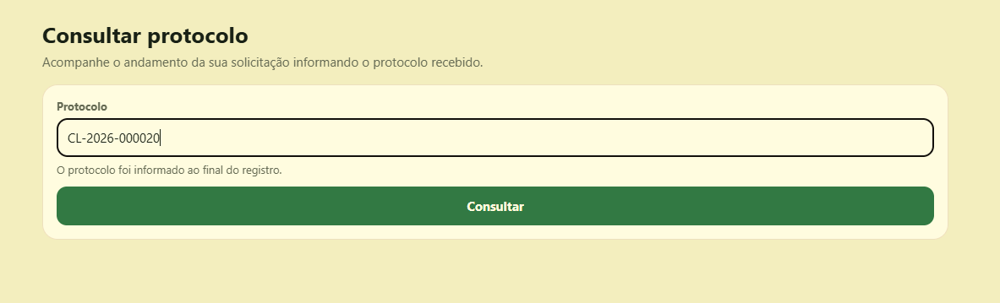
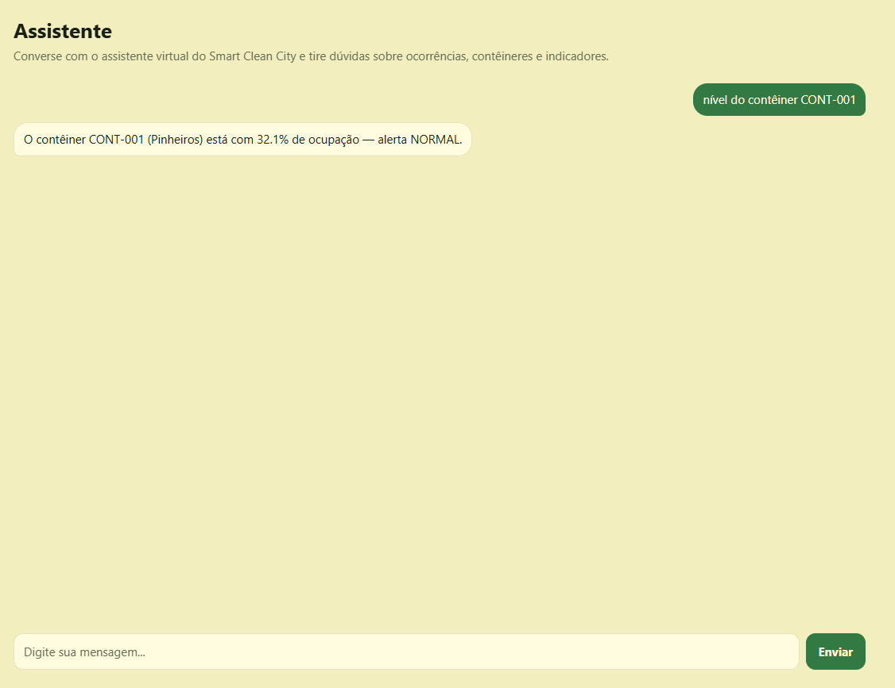
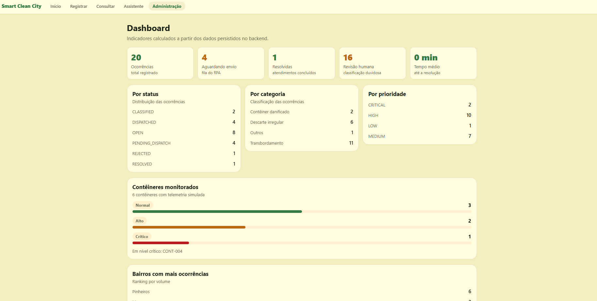
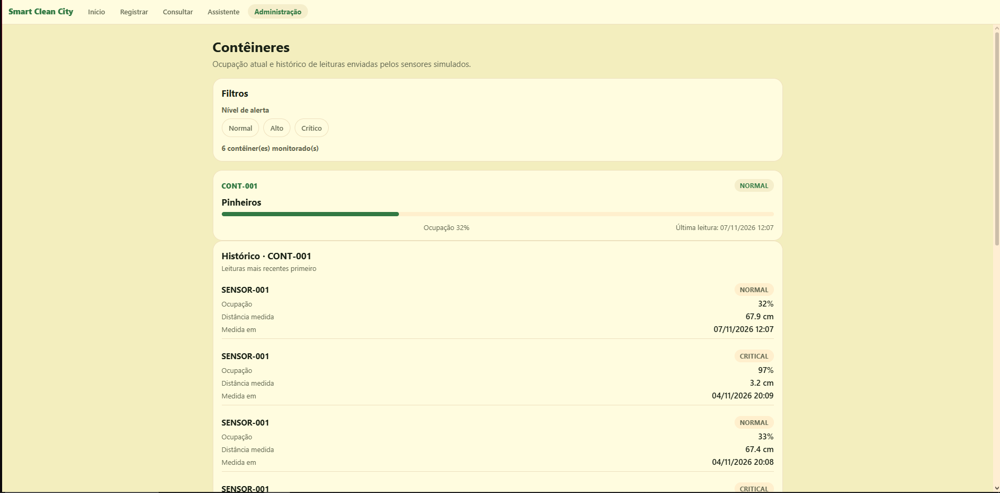
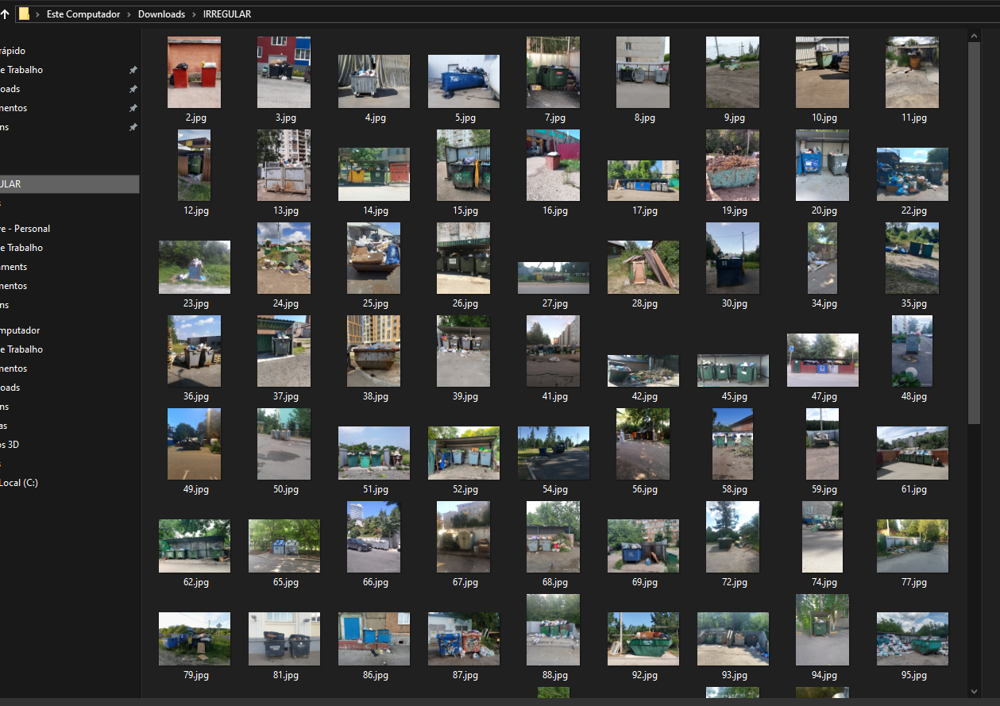
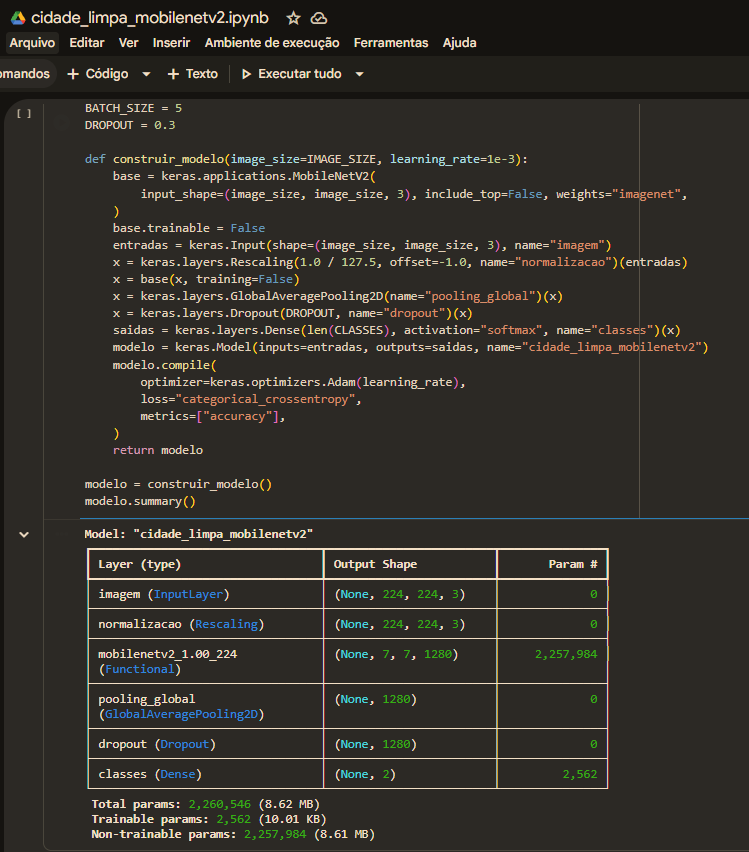

# Smart Clean City

<p align="center">
  <a href="https://www.fiap.com.br/"></a>
</p>

<p align="center">
  <strong>Smart Clean City</strong><br>
</p>

**Plataforma Inteligente de Monitoramento de Resíduos e Descartes**

**FIAP Global Solution 2026 — CitizenTech**.

---

## Autor

| Nome | RM |
|---|---|
| [Renan de Oliveira Mendes](https://www.linkedin.com/in/renanmendes26/) | RM563145 |

## Vídeo

- **Vídeo:** https://youtu.be/1yjFrGTnjYM
- **App:** https://youtube.com/shorts/LTwZ9T6SLUE
---

## 1. Problema

Hoje o Brasil apresenta um grande problema de descarte irregular de resíduos e de precariedade no saneamento básico. É um dos maiores desafios da saúde pública e meio ambiente, com impactos graves na qualidade de vida da população.

Cerca de 33,3 milhões de toneladas de lixo foram descartadas de forma inadequada no país em 2022, segundo dados da Associação Brasileira de Empresas de Resíduos Públicos e Privados. A geração total chega a aproximadamente 77,1 milhões de toneladas.

Resíduos descartados nas ruas entopem bueiros e galerias pluviais, gerando inundações em períodos de chuva.

O acúmulo de lixo e a falta de saneamento geram chorume e favorecem vetores de doenças como dengue, leptospirose, esquistossomose, febre tifoide e diarreias severas.


Com isso surge a necessidade de identificar, registrar, monitorar e encaminhar ocorrências de descarte irregular de resíduos. Hoje, esse processo é um processo manual, fragmentado e sem rastreabilidade.


### 1.1 Fontes:

- https://www.abrema.org.br/2024/07/18/brasil-destinou-333-milhoes-de-toneladas-de-lixo-de-forma-inadequada-em-2022/

- https://saneamentobasico.com.br/acervo-tecnico/descarte-irregular-lixo-agravar-alagamentos/

- https://www.ibeas.org.br/conresol/conresol2024/IV-020.pdf

## 2. Solução

O **Smart Clean City** permite que o cidadão crie uma ocorrência com foto e localização, que um modelo
de visão computacional classifique a imagem, que a demanda seja enviada automaticamente para um
portal administrativo, via RPA, e que o funcionario acompanhe os indicadores, contêineres e
execuções em um dashboard.

A solução entrega um ecossistema integrado: o **cidadão** registra a ocorrência com foto e bairro;
um **modelo de visão computacional** (MobileNetV2) classifica a imagem (`REGULAR`/`IRREGULAR`), com o
backend calculando categoria e prioridade; a demanda é encaminhada automaticamente por um **RPA
(Playwright)** a um portal administrativo demonstrativo; contêineres são monitorados por **sensores
simulados** (ESP32 virtual) e um **agente conversacional** responde com dados reais. Um **dashboard**
consolida os indicadores.

**Perfil:**

- **Cidadão:** página inicial, registro de ocorrência com foto, bairro e localização, visualização da
classificação da IA, geração de protocolo, consulta de status e conversa com o assistente.

- **Administrador:** dashboard de indicadores, consulta e filtro de ocorrências por categoria/status,
visualização de imagens e classificações, monitoramento de contêineres, histórico de sensores,
execuções do RPA e histórico do agente.


### 2.1 Frontend - Mobile e Web

Foi desenvolvido do zero duas formas de interagir com o usuário, uma página Web e um app mobile.
Ambas tem as mesmas funcionalidades e compartilham o mesmo backend, fazendo consultas por meio de consumo de APIs.

Tanto no website como no app existe a funcionalidade de mudar o perfil de acesso - Cidadão ou Administrador.

O cidadão tem acesso as funcionalidades de criar um registro e acompanhar, enquanto o administrador pode fazer o mesmo, tem mais visibilidade de informações técnicas, consegue consultar o dashboard e fazer o monitoramento dos containers.



A aplicação mobile foi desenvolvida de forma responsiva, testada e disponibilizada usando Expo Go.



### 2.2 Funcionalidades

#### Registrar

A principal funcionalidade é a criação de um registro por parte do cidadão.
Na aba registrar existe um formulário onde o usuário insere informações como bairro, endereço, categoria do incidente, mais informações e pode fazer o upload de uma imagem. 




Por trás há um modelo de visão computacional MobileNetV2 treinado com mais de 150 imagens. Esse modelo vai inferir se a imagem mostra uma situação de descarte/armazenamento Regular ou Irregular.



Essa inferência serve como gatilho interno para acionar um protocólo de RPA com multiagentes. Esses por sua vez vão fazer uma classificação do incidente e decidir se encaminham para iniciar um atendimento com a equipe humana.

#### Consultar

Na aba consultar, o usuário pode inserir o código de atendimento e verificar a situação do report enviado. Por trás existe um programa que realiza consultas CRUD no banco de dados da solução.




#### Assistente

Incorporando LLMS, criamos uma interface com um agente conversacional inteligente. Esse agente dispoe de tools para realizar consultas, criar um registro rápido e consultar informações técnicas.



#### Monitoramento com IOT

Dentro de administração com o perfil de acesso de administrador, podemos visualizar um dashboard com diversas informações.

- Cards de registros
- Cards de monitoramento contêineres
- Cards de monitoramento por bairro



Além do dashboard, clicando em ver contêineres, é onde fazemos o monitoramento de cada microprocessador e sensores embutido em contêineres. Aqui é onde fica visível a parte de IOT integrada na solução.



### 2.3 Modelo de visão computacional - MobileNetV2

Modelo treinado no Google Colab, em `ml/models/`




| Métrica | Valor real |
|---|---|
| **Acurácia (conjunto de teste)** | **0,7273** (72,73%) |
| Precisão ponderada | 0,7336 |
| Recall ponderado | 0,7273 |
| F1 ponderado | 0,7242 |
| Matriz de confusão (33 imagens) | `[[10, 6], [3, 14]]` |
| Dataset | ~103–104 imagens/classe (treino 72/72, val 15/15, teste 16/17) |
| Arquitetura | MobileNetV2 (ImageNet) + transfer learning |


## 3. Como executar cada módulo

### 3.1 Pré-requisitos

- Python 3.13, Node.js 22 + npm.

### 3.2 Instalação

```powershell
# Python (backend + simulador + RPA + ML)
python -m venv .venv
.venv\Scripts\Activate.ps1          # Linux/macOS: source .venv/bin/activate
python -m pip install -r requirements.txt -r requirements-dev.txt

# Frontend
cd frontend
npm install
cd ..
```

### 3.3 Backend

```powershell
cd backend
python -m app.db.seed                       # dados de demonstração
python -m uvicorn app.main:app --reload --host 0.0.0.0 --port 8000
```

> **Importante para testar no celular com Expo Go:** use `--host 0.0.0.0` para o backend aceitar
> conexões da rede local. Se o app mostrar "Não foi possível conectar à API", verifique também se o
> firewall do Windows libera a porta 8000. 

- Documentação interativa: http://127.0.0.1:8000/docs
- Saúde: `GET http://127.0.0.1:8000/health` → `"model_loaded": true`


### 3.4 Frontend (web e mobile)

```powershell
cd frontend
npm run web          # React Native Web 
# ou
npm start            # Expo 
```

O app descobre a URL da API automaticamente.

### 3.5 Simulador IoT

```powershell
# com o backend rodando
python -m simulator.sensors.runner            # envia a cada 10 s
python -m simulator.sensors.runner --once     # uma rodada
python -m simulator.sensors.runner --critical # força nível crítico (>=90%)
```


### 3.6 Portas e configuração

| Recurso | Porta | Variável principal |
|---|---|---|
| Backend (API) | 8000 | uvicorn `--host`/`--port` (padrão `--host 0.0.0.0`), `DATABASE_URL` |
| Frontend web | 8081 | `EXPO_PUBLIC_API_URL` |
| Portal fictício | 8100 | `RPA_PORTAL_URL` |


## 4. Tecnologias

| Camada | Stack |
|---|---|
| Frontend | React Native, Expo, Expo Router, React Native Web (responsivo desktop/mobile) |
| Backend | Python, FastAPI, Pydantic, SQLAlchemy, SQLite, API REST |
| Machine Learning | TensorFlow/Keras, MobileNetV2 (transfer learning), OpenCV/Pillow, Scikit-learn |
| IoT | Python, ESP32 simulado, sensor ultrassônico virtual, HTTP/JSON |
| RPA | Python, Playwright, portal administrativo fictício |
| Agente | Python, interpretação de intenções, ferramentas que consultam a API (sem LLM externo) |
| Qualidade | Pytest, testes de frontend, GitHub Actions, GitHub privado |

## 5. Arquitetura em uma frase

O **FastAPI é o núcleo**: o frontend consome exclusivamente a API REST, o modelo MobileNetV2 é
carregado pelo serviço de classificação do backend, o simulador Python envia telemetria para os
endpoints de sensores, o RPA consome a fila de demandas e o agente consulta dados persistidos — tudo
sobre o mesmo SQLite.

Detalhes em [`docs/ARCHITECTURE.md`](docs/ARCHITECTURE.md).

## 6. Estrutura do repositório

```
Global_Solution2/
├── backend/
│   ├── app/                  # aplicação FastAPI
│   │   ├── api/routes/       # routers por domínio
│   │   ├── core/             # configuração, enums, regras transversais
│   │   ├── db/               # engine, sessão e inicialização do banco
│   │   ├── models/           # modelos SQLAlchemy
│   │   ├── schemas/          # schemas Pydantic (entrada/saída)
│   │   └── services/         # regras de negócio, ML, RPA, agente
│   └── tests/                # testes Pytest do backend
├── frontend/                 # app Expo / React Native Web
│   ├── src/app/              # rotas (Expo Router): cidadão e admin
│   ├── src/components/       # UI reutilizável
│   ├── src/services/         # cliente HTTP e endpoints da API
│   └── src/lib/              # formatação e validação
├── ml/
│   ├── data/raw/             # dataset de entrada (não versionado)
│   ├── data/processed/       # dataset tratado (não versionado)
│   ├── notebooks/            # treino no Colab
│   ├── src/                  # pipeline (dataset, modelo, treino, avaliação)
│   ├── models/               # pesos e metadados (não versionados)
│   └── reports/              # métricas, matriz de confusão (não versionado)
├── simulator/                # sensores virtuais de contêineres (FASE 4)
│   ├── config.py             # Settings e especificações dos sensores
│   ├── core/sensor.py        # sensor ultrassônico virtual
│   └── sensors/runner.py     # loop de envio + CLI
├── rpa/                      # robô Playwright + portal fictício (FASE 5)
│   ├── portal/server.py      # portal administrativo fictício (HTTP local)
│   └── bot/dispatcher.py     # robô: fila → preenchimento → captura de protocolo
├── .github/workflows/ci.yml  # integração contínua (backend + frontend)
├── data/                     # SQLite e uploads em runtime (não versionados)
└── docs/                     # documentação do projeto
```

## 7. Documentação

| Documento | Conteúdo |
|---|---|
| [`docs/ARCHITECTURE.md`](docs/ARCHITECTURE.md) | Componentes, fluxos e decisões de arquitetura |
| [`docs/BUSINESS_RULES.md`](docs/BUSINESS_RULES.md) | Regras de negócio aplicadas |
| [`docs/DATA_MODEL.md`](docs/DATA_MODEL.md) | Entidades, colunas, enums e índices |

## 8. Como preparar o ambiente

```bash
# 1. Clonar e entrar no repositório
git clone <url-do-repositorio-privado>
cd Global_Solution2

# 2. Criar e ativar o ambiente virtual
python -m venv .venv
.venv\Scripts\activate           # Windows (PowerShell)
# source .venv/bin/activate      # Linux/macOS

# 3. Instalar dependências
python -m pip install -r requirements.txt -r requirements-dev.txt

# 4. Configurar variáveis de ambiente
copy .env.example .env           # Windows (PowerShell)
# cp .env.example .env           # Linux/macOS
```


## 9. Qualidade

```bash
python -m ruff check .           # lint
python -m ruff format --check .  # formatação
python -m pytest                 # testes (149, cobertura 88%)
cd frontend && npm test -- --ci  # testes de frontend
```
